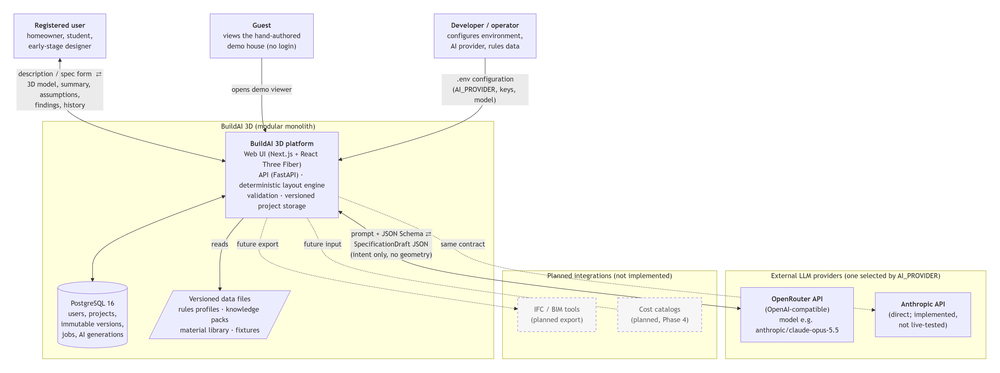
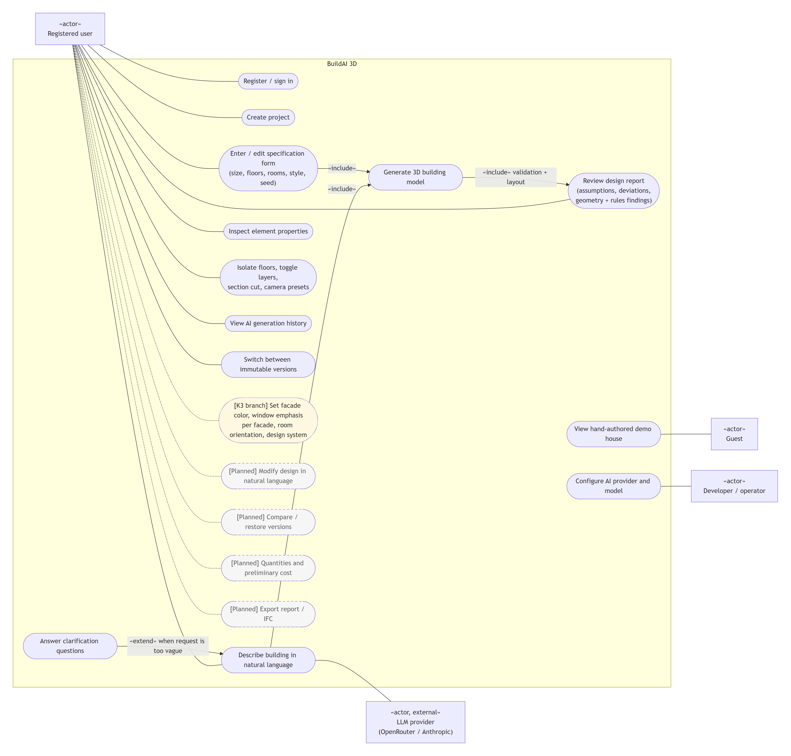
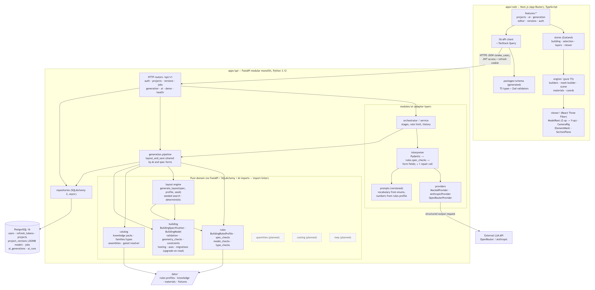

# 07 — Architecture and Diagrams

> The diagrams show `main` @ `7830248` unless marked otherwise. Editable sources are Mermaid (`.mmd`). Exports are SVG (vector) and PNG (2× raster), rendered with Mermaid 11 in headless Chrome on 2026-10-20.
> The detailed design documents remain the source of truth: [`docs/architecture.md`](../architecture.md), [`docs/building-model.md`](../building-model.md), [`docs/ai-pipeline.md`](../ai-pipeline.md), [`docs/3d-engine.md`](../3d-engine.md), [`docs/database.md`](../database.md). This document summarizes them for the pre-defense and doesn't replace them.

| # | Diagram | Source | SVG | PNG |
|---|---|---|---|---|
| 1 | System Context | [diagrams/01-system-context.mmd](diagrams/01-system-context.mmd) | [svg](diagrams/01-system-context.svg) | [png](diagrams/01-system-context.png) |
| 2 | Use Case | [diagrams/02-use-case.mmd](diagrams/02-use-case.mmd) | [svg](diagrams/02-use-case.svg) | [png](diagrams/02-use-case.png) |
| 3 | Component (draft) | [diagrams/03-component.mmd](diagrams/03-component.mmd) | [svg](diagrams/03-component.svg) | [png](diagrams/03-component.png) |

To regenerate after editing a `.mmd` file, use any Mermaid renderer, e.g. `npx @mermaid-js/mermaid-cli -i 01-system-context.mmd -o 01-system-context.svg` (not a project dependency), or paste the source into <https://mermaid.live>.

Notation used in all three diagrams: **solid** = implemented on `main` · **dotted, light yellow** = committed on the unmerged K3 branch · **dashed, grey** = planned, not implemented.

## 1. The current generation flow (implemented)

```
User ──▶ Web UI (Next.js) ──▶ API (FastAPI, /api/v1)
                                 │
                                 ├─▶ AI provider (mock | OpenRouter | Anthropic)
                                 │       returns SpecificationDraft JSON  ◀── intent only, no coordinates
                                 ▼
                         Validation tier 1: Pydantic schema
                         Validation tier 2: rules.spec_checks (BuildingRulesProfile generic-residential@1)
                         Form-field checks · ≤ 1 repair call · invalid output never accepted
                                 ▼
                         BuildingSpecification (validated)        ◀── spec-form path joins here (no AI)
                                 ▼
                         generation.pipeline.layout_and_save
                           └─ layout.engine.generate_layout(spec, profile, seed)   deterministic
                                 ▼
                         BuildingModel (typed elements, UUIDv5 semantic ids)
                                 ▼
                         validate_model: invariants + reachability + 37 geometric constraints
                         rules.model_checks
                                 ▼
                         New immutable project_versions row (JSONB) + ai_generations record
                                 ▼
Web UI ◀── model JSON (Zod-validated) ──▶ engine/ (pure TS builders) ──▶ viewer/ (React Three Fiber)
```

The LLM sits **before** validation and never touches geometry, meshes or IDs. Both the AI path and the specification-form path go through the same `layout_and_save` step (CLAUDE.md, "AI generation notes").

## 2. Diagram 1 — System Context



| Element | Description | Status |
|---|---|---|
| Registered user | Describes buildings, edits specs, inspects models, reviews history | Implemented |
| Guest | Opens the hand-authored demo house at `/` without logging in | Implemented |
| Developer / operator | Sets `.env` (DB URL, JWT secret, `AI_PROVIDER`, keys, model) and maintains the rules and knowledge data files | Implemented |
| BuildAI 3D platform | Web UI + API + layout engine + validation, one deployable unit (modular monolith, ADR in `docs/architecture.md` §1) | Implemented |
| PostgreSQL 16 | Users, refresh tokens, projects, immutable versions, jobs, AI generations and runs | Implemented |
| Versioned data files | `data/rules-profiles`, `data/knowledge` (hash-locked), `data/materials`, `data/fixtures` | Implemented |
| OpenRouter API | External LLM gateway (OpenAI-compatible). Live-tested once with `anthropic/claude-opus-5.5` | Implemented |
| Anthropic API | Direct provider through the official SDK. Unit-tested, never called live | Implemented, not live-verified |
| IFC / BIM tools, cost catalogs | Future integrations | Planned |

## 3. Diagram 2 — Use Case



Mermaid has no UML use-case notation, so actors are «actor» boxes and use cases are stadium shapes inside the system boundary. If the university template requires strict UML, redraw the same content in a UML tool (e.g. draw.io or PlantUML). The content is final, the notation isn't.

| Use case | Primary actor | Status | Evidence |
|---|---|---|---|
| Register / sign in | Registered user | Implemented | `test_auth.py` |
| Create project | Registered user | Implemented | `test_projects.py`; screenshot 02 |
| Describe building in natural language | Registered user (+ LLM provider) | Implemented | screenshots 03–05 |
| Answer clarification questions (extends NL description) | Registered user | Implemented | screenshot 12 |
| Enter / edit specification form | Registered user | Implemented | screenshot 10 |
| Generate 3D building model (included by both input paths) | — | Implemented | screenshots 05, 11 |
| Inspect element properties | Registered user | Implemented | screenshot 06 |
| Isolate floors, layers, section, cameras | Registered user | Implemented | screenshot 07 |
| Review design report | Registered user | Implemented | screenshot 08 |
| View AI generation history | Registered user | Implemented | screenshot 09 |
| Switch between immutable versions | Registered user | Implemented | screenshot 11 (version selector "v2 … / v1 …") |
| View demo house | Guest | Implemented | screenshot 01 |
| Configure AI provider and model | Operator | Implemented | `test_provider_selection.py` |
| Facade color, window emphasis per facade, room orientation, design system | Registered user | **K3 branch, not merged** | branch commit `cc59d3f` |
| Modify design in NL; compare/restore; quantities and cost; export | Registered user | Planned | `docs/roadmap.md` Phases 4, 5, 7 and backlog |

## 4. Diagram 3 — Component diagram (draft)



### 4.1 Web (`apps/web/src`)

| Component | Responsibility | Key rule |
|---|---|---|
| `features/*` | Vertical slices: projects dashboard, AI generator, generation drawer/spec form, editor, versions/report, auth | — |
| `stores/` (Zustand) | Building being viewed, selection, layers, viewer state, auth, project | Granular selectors |
| `lib/api` + TanStack Query | Server state; responses validated by generated Zod schemas | snake_case JSON, no remapping |
| `packages/schema` | Generated TS types + Zod validators | Never hand-edited (`pnpm schema`) |
| `engine/` | Pure TS: `(element, ctx) → RenderDescriptor[]`, all geometry via `mesh-builder.ts`, materials from `data/materials/library.json` | No React, no stores; deterministic |
| `viewer/` | React Three Fiber scene; `ModelRoot` is the single Z-up → Y-up conversion | Every mesh maps to one element `{elementId, part}` |

### 4.2 API (`apps/api/app`)

| Component | Responsibility | Boundary rule |
|---|---|---|
| Routers (`modules/*/router.py`) | HTTP only: auth, projects, versions, jobs, generation, ai, demo, health | Error envelope `{error:{code,message,details}}` |
| `modules/ai` | Orchestrator (real stages, rate limit, history), interpreter (validation + ≤ 1 repair), versioned prompts, providers | Vendor SDK only in `providers/<vendor>.py` (import-linter) |
| `generation.pipeline` | `layout_and_save`: resolve types → layout → validate → rules → new version | The only module that imports the catalog (import-linter) |
| `building` | Canonical Pydantic spec and model, validation, geometric constraints, hosting, axes, upgrade-on-read migrations | Pure domain |
| `rules` | `BuildingRulesProfile` loader, spec/model/type checks | The only source of dimensional limits |
| `layout` | Deterministic layout engine (`layout@1.2.0` on main) | Pure; no I/O, no wall clock, seeded RNG only |
| `catalog` | Knowledge packs, families/types/assemblies, gated resolver (approved records only) | Pure; consumed only via the pipeline |
| `quantities`, `costing`, `mep` | Empty packages reserved for Phases 4 and 6 | Planned |
| Repositories (SQLAlchemy 2 async) | Persistence | Not imported by domain modules |

import-linter on 2026-10-20: **5 contracts kept, 0 broken**:
1. Domain modules stay pure (no web, persistence or AI imports).
2. The knowledge catalog depends only on the building schemas.
3. Only the generation pipeline consumes the knowledge catalog.
4. Core does not depend on feature modules.
5. Vendor AI SDKs are imported only by their provider adapter (1 declared exception: `ai.providers.anthropic → anthropic`).

### 4.3 K3 changes (branch only, for orientation)

The K3 branch adds `building/design.py` (deterministic precedence), `building/facades.py` and `building/appearance.py`, `catalog/design_systems.py`, `GET /api/v1/design-options`, a Design section in the spec form, prompt `building-generation@2`, `layout@1.3.0`, spec 1.1.0 and BuildingModel 1.2.0. **These are not on `main` and are not drawn as implemented.**

## 5. Data model summary (implemented)

`users` → `projects` (owner) → `project_versions` (immutable, `model` JSONB + spec, seed, rules profile, engine version, provenance) · `jobs` (spec-form generation) · `ai_generations` → `ai_runs` (per provider call) · `refresh_tokens` (hashed, rotating). Details: [`docs/database.md`](../database.md).

## 6. Changes to existing architecture documentation

None were needed for this package. Two **inconsistencies were found and left for the team** to fix, so this sprint doesn't touch files the K3 branch also edits (to avoid merge conflicts):

1. `docs/roadmap.md` (main) marks K2 as "branch, awaiting review", but K2 (`9d94bb0`) is in `main`'s history.
2. `docs/architecture.md` §2 still draws MEP, quantities, costing and AI analysis in the end-to-end pipeline without marking them planned. §2 also says "max 2 repairs", while the configured default is 1 (`AI_MAX_REPAIRS`, allowed 0–2).
