# 08 — UX and Prototype

> **All screenshots below are genuine captures of the running application** (branch `main` @ `7685bf9`). They were taken on 2026-10-20 with headless Chrome at 1440×900, against a local API and embedded PostgreSQL.
> **Capture conditions:** `AI_PROVIDER=mock` (the deterministic offline interpreter). The UI labels this "Offline mock interpreter (development mode)" and "mock interpreter", so **no real LLM output is shown in these images**. A throwaway local test account was used (display name "Pre-defense Demo"); it holds no personal data. The only change to the page was hiding the Next.js dev-mode indicator badge with CSS.
> **No mockups are presented as implemented features.**

## 1. Runnable prototype

There is no public deployment. To run the prototype locally, follow the repository [README](../../README.md) (Option B, no Docker):

```bash
pnpm install
pnpm api:install
pnpm db:local
pnpm migrate
pnpm dev
```

Then open <http://localhost:3000> (demo house, no login) or register and go to `/projects`. To avoid paid API calls during a demo, set `AI_PROVIDER=mock` in `.env`. To show a real LLM, set `AI_PROVIDER=openrouter` with a key (it costs money; see the cost tracking in [09](09_verification_and_evaluation_plan.md)).

## 2. Key scenarios

### S1 — Describe a building (natural language)

The dashboard's AI panel has a 4000-character prompt box, example prompts, and optional structured details (area, floors, style, budget, region).

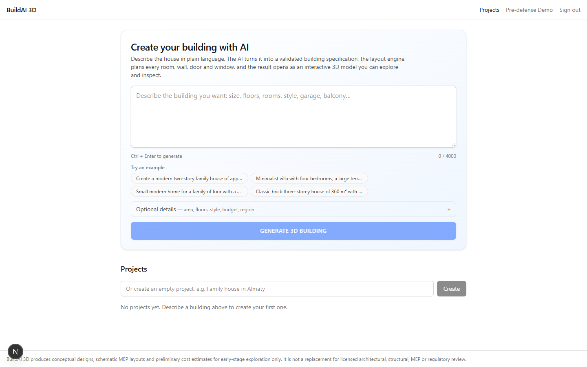
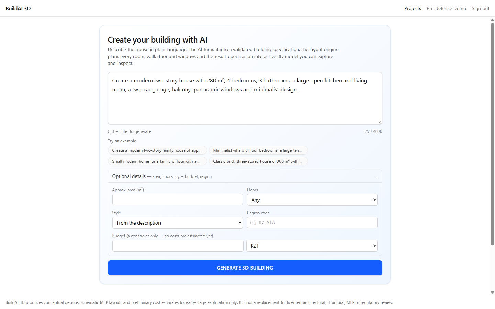

### S2 — Specify size, floors and rooms

There are two ways: (a) in the prompt or the optional details (S1), or (b) the **Specification form** in the "New design" drawer. The form offers reference presets, floors 1–3, floor area, floor height, style, roof, windows, facade, interior finish, a room list with per-room area and floor, and a garage. "Check specification" validates the spec without generating.

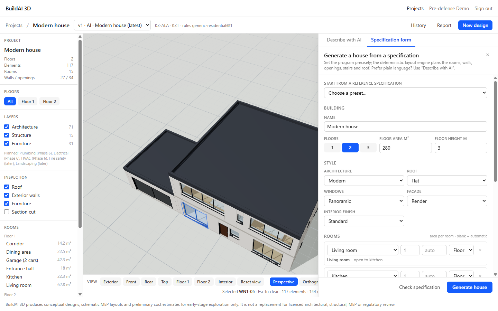

### S3 — Select appearance

- **On `main` (shown):** the form's style, roof (flat/gable/hip), windows (standard/large/panoramic), facade material (render/brick/concrete/timber) and interior finish (screenshot 10).
- **On the K3 branch (not merged, not shown):** facade color, per-facade window emphasis, room orientation and design-system selection. **No screenshot exists yet.** See the capture checklist in §4.

### S4 — Generate a 3D model

Generation shows the **real pipeline stages** recorded on the server (understanding → validating → layout → rules → saving → building the 3D model). Progress is not invented (ADR-013).

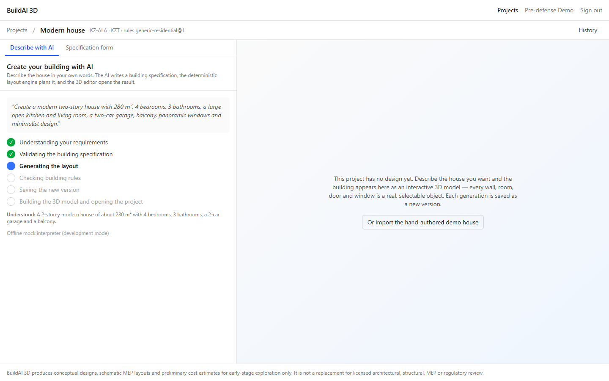
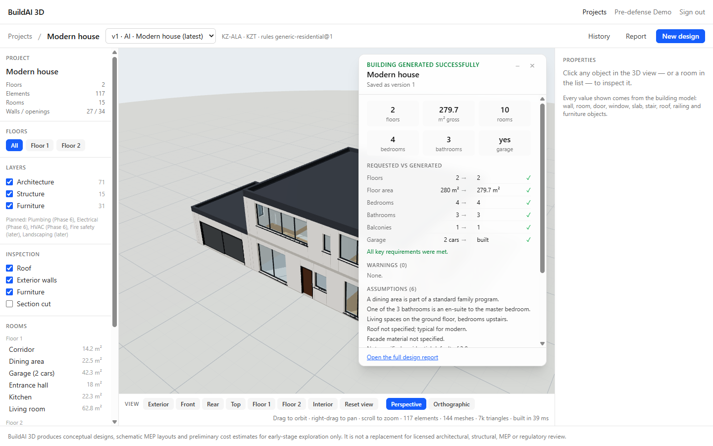

Result for the demo prompt (mock interpreter): 2 floors, 279.7 m² gross (280 requested), 4 bedrooms, 3 bathrooms, 1 balcony, garage built. "All key requirements were met", 0 warnings, 6 assumptions listed.

### S5 — Inspect floors and elements

Clicking an element selects it and opens a properties panel with all its values: dimensions, material, placement, properties, component type, relationships (e.g. *Hosted by W1-01 (Exterior wall)*) and identity (UUID, semantic key, layer, origin, locked). Floor isolation ghosts the other floors.

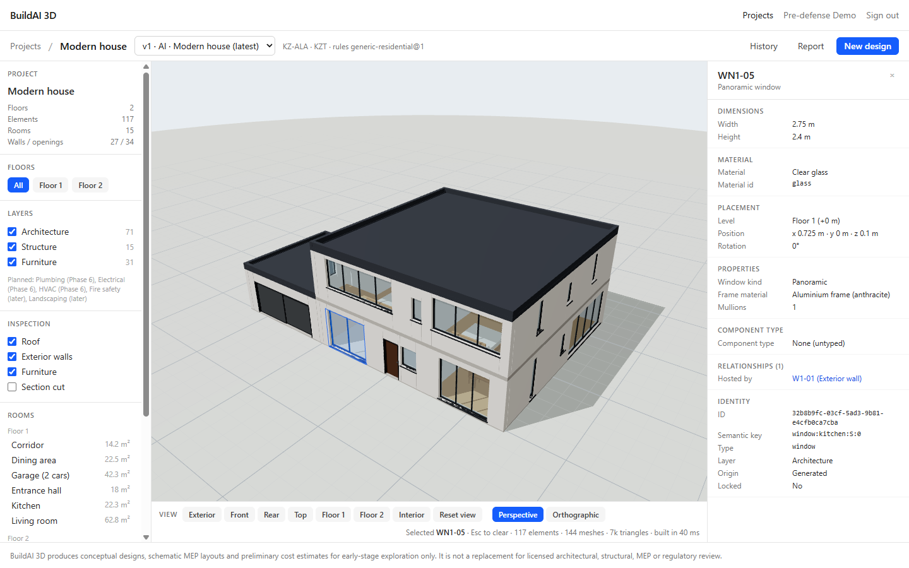
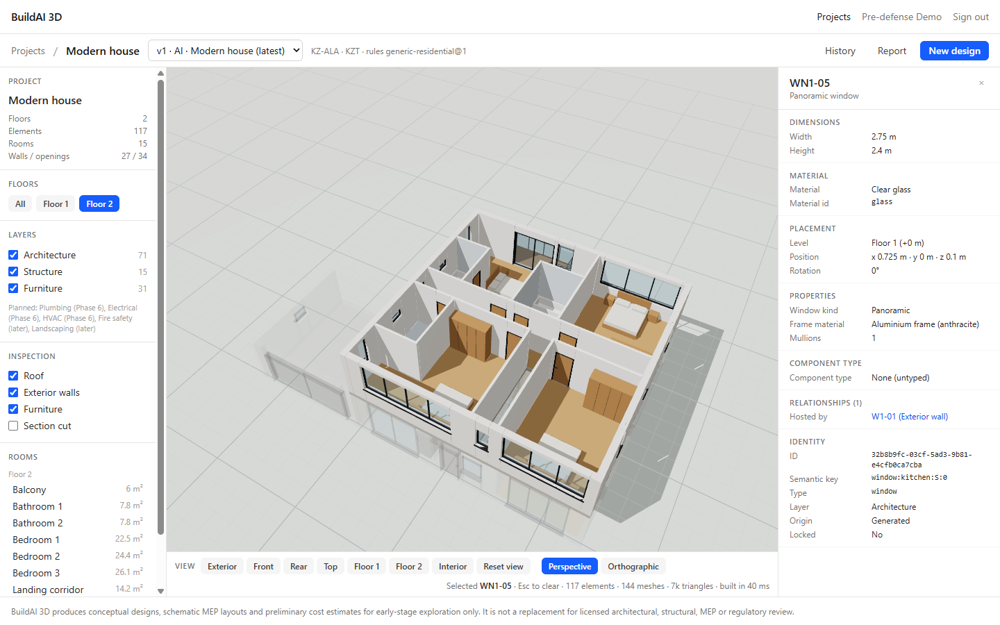

### S6 — Review assumptions and warnings

The summary card (screenshot 05) and the **design report** list the request, the interpreter and prompt version, differences from the request, assumptions, engine notes, geometry checks, the rules check, and the disclaimer.

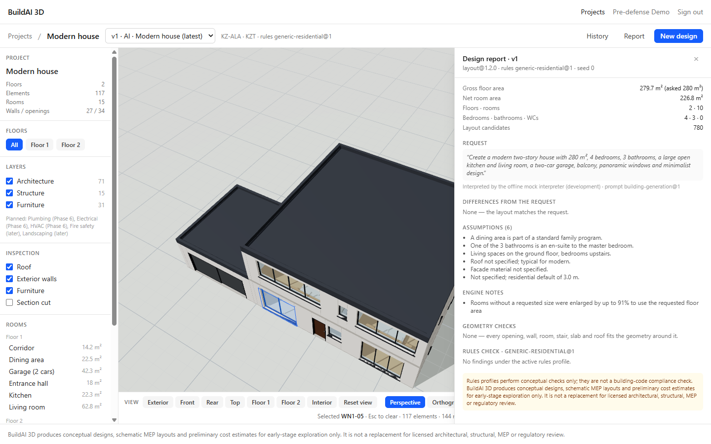

### S7 — Inspect geometric validation findings

The design report's **"Geometry checks"** section reports K2.5 findings. For this model it reads "None — every opening, wall, room, stair, slab and roof fits the geometry around it" (screenshot 08). **A screenshot of a model with actual findings is not available yet**, because generated models are valid by construction. To show the finding UI, a deliberately invalid hand-edited model would be needed (see §4, item C5).

### S8 — Clarification for vague requests

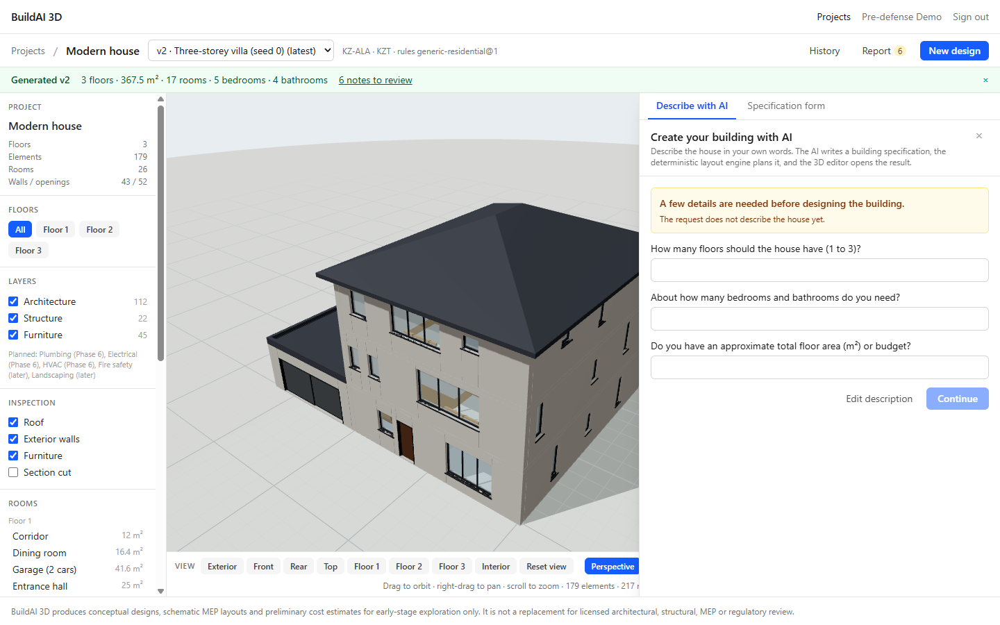

### S9 — View project versions and history

Every generation creates a new immutable version. The version selector shows `v2 · Three-storey villa (seed 0) (latest)` and `v1 · AI · Modern house`, and the AI history drawer lists each description with its status, provider and duration.

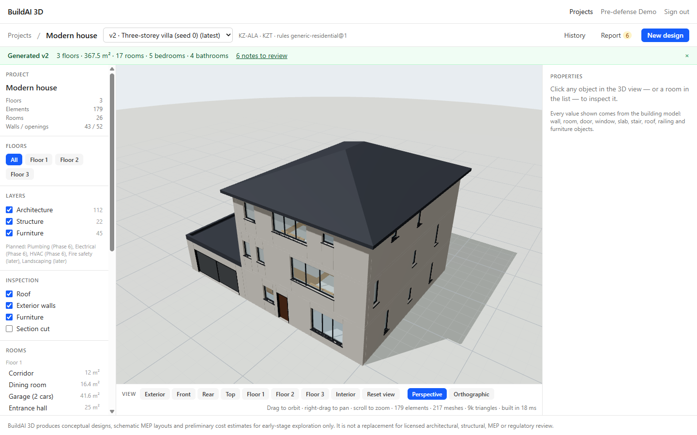
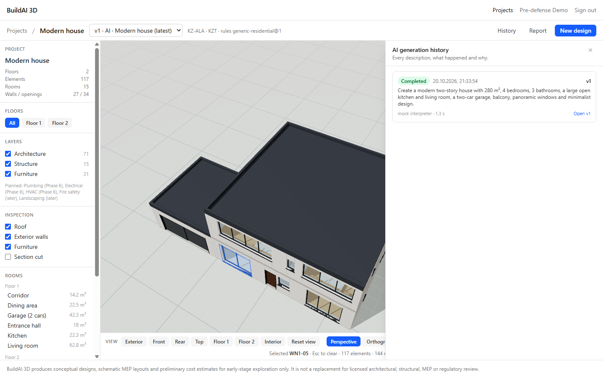

### S10 — Demo house (no login)

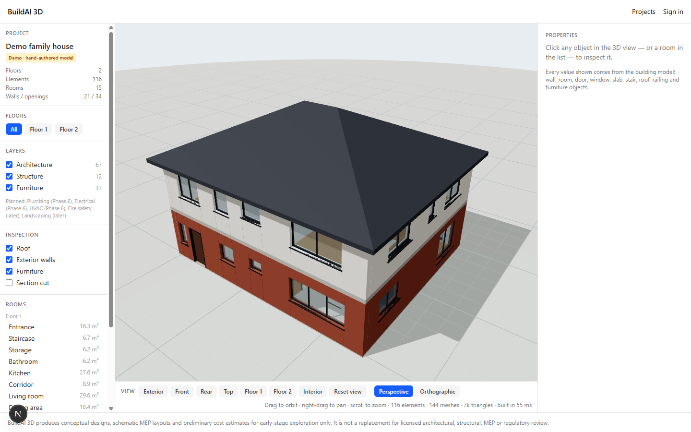

## 3. UX principles applied (with source)

| Principle | Where in the UI | Source |
|---|---|---|
| Make clear what the system can do | Example prompts; "Offline mock interpreter" label; disclaimer in the footer | [S14] |
| Make clear why the system did what it did | Requested-vs-generated table, assumptions, engine notes, report | [S14] |
| Support efficient correction | Clarification questions; specification form for precise edits; new version per change | [S14] |
| Show real progress | Stage list from server-recorded stages | ADR-013 |
| Every value comes from the model | Properties panel reads model fields only | CLAUDE.md rule 1 |

Known UX limitations: English UI only. No onboarding tour. The version dropdown can't compare versions (Phase 5). Usability has **not** been tested with users ([09](09_verification_and_evaluation_plan.md), NFR-U1).

## 4. Screenshot capture checklist

| # | Asset | Status | File / instruction |
|---|---|---|---|
| C1 | Demo house viewer | ✔ captured | `assets/screenshots/01-demo-house-viewer.png` |
| C2 | Dashboard, prompt, progress, generated model | ✔ captured | `02`–`05` |
| C3 | Properties, floor isolation, report, history, spec form, version 2, clarification | ✔ captured | `06`–`12` |
| C4 | **Real LLM** generation (OpenRouter) summary showing the provider label | ☐ outstanding | Run one live generation with `AI_PROVIDER=openrouter`, capture summary + history; record cost |
| C5 | Geometry finding displayed in the report | ☐ outstanding | Requires a deliberately invalid model (e.g. import a hand-edited model with an opening outside its wall); decide with supervisor whether it's worth it |
| C6 | **K3**: spec-form Design section, yellow facade, panoramic windows on the rear facade | ☐ outstanding | Check out `phase-3.5-k3-design-systems`, run, capture; label "K3 branch, not merged" |
| C7 | Failure message for an infeasible request | ☐ outstanding | e.g. a prompt with impossible area/room combination |
| C8 | Mobile/narrow viewport | ☐ optional | The editor is desktop-first; capture only if requested |
